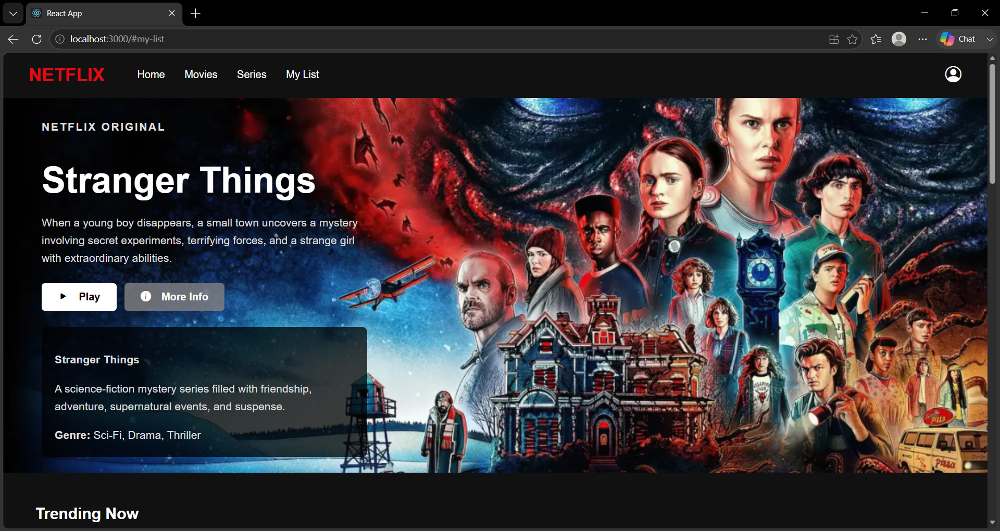
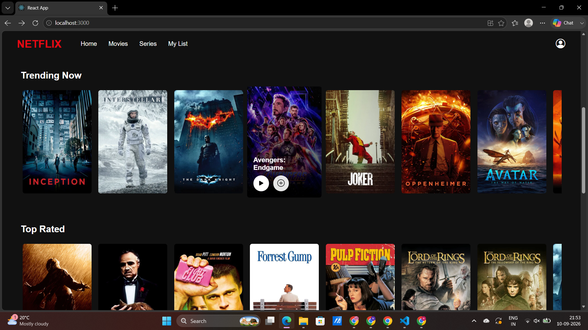
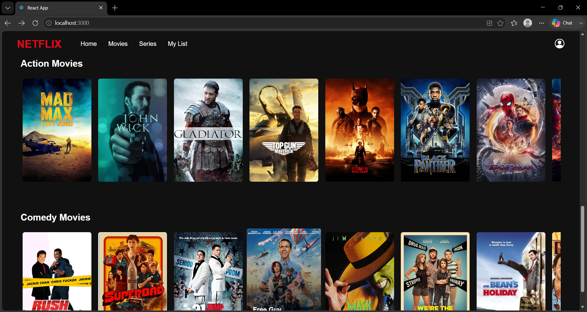
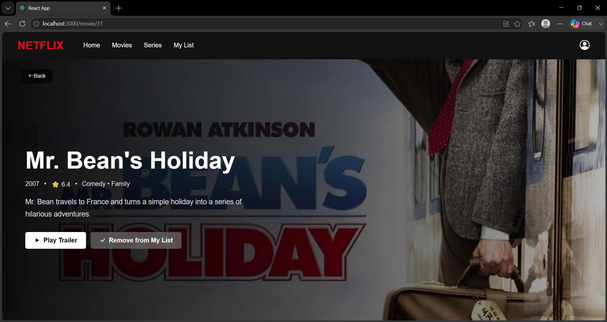
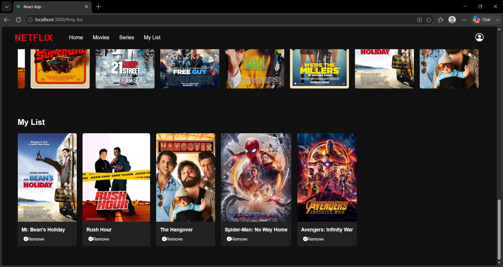

<div align="center">

# 🎬 Netflix Clone

---

## 🍿 About The Project

This project is a **Netflix-inspired frontend application built with React**.

The goal was to create a modern streaming-platform experience with a Netflix-style interface, movie categories, a hero banner, movie details, trailers, and a personal **My List** section.

> 🎥 This project is focused on the frontend UI and does not use a backend or database.

---

## ✨ Features

🎬 **Netflix-style Navbar**

🌅 **Large Hero Banner**

🔥 **Trending Movies**

⭐ **Top Rated Movies**

💥 **Action Movies**

😂 **Comedy Movies**

▶️ **Movie Trailer Playback**

ℹ️ **Movie Details**

➕ **Add Movies to My List**

✅ **Remove Movies from My List**

🎭 **Dedicated Movie Details Page**

🖱️ **Movie Card Hover Effects**

📱 **Responsive Design**

🚦 **React Router Navigation**

---

## 🛠️ Tech Stack

<div align="center">

| Technology | Usage |
|---|---|
| ⚛️ React | Frontend UI |
| 🟨 JavaScript | Application Logic |
| 🎨 CSS3 | Styling & Responsive Design |
| 🚦 React Router | Page Navigation |
| 🎯 Bootstrap Icons | Interface Icons |

</div>

---

## 🏠 Home Page



<br><br>

## 🎬 Home Page – Movie Rows



<br><br>

## 🍿 Home Page – Additional View



<br><br>

## 🎥 Movie Details



<br><br>

## ❤️ My List



</div>

---

# 🎯 Application Flow

```text
                    🎬 NETFLIX CLONE
                           │
                           ▼
                      🏠 Home Page
                           │
          ┌────────────────┼────────────────┐
          ▼                ▼                ▼
       🔥 Trending      ⭐ Top Rated      💥 Action
          │                │                │
          └────────────────┼────────────────┘
                           ▼
                     😂 Comedy Movies
                           │
                           ▼
                       ❤️ My List
                           │
                           ▼
                    🎬 Movie Details
                           │
                           ▼
                     ▶️ Watch Trailer


📂 Project Structure
NETFLIX/
│
├── public/
│
├── src/
│   │
│   ├── components/
│   │   ├── Hero.js
│   │   ├── Hero.css
│   │   ├── Navbar.js
│   │   ├── Navbar.css
│   │   ├── MovieCard.js
│   │   ├── MovieCard.css
│   │   ├── MovieRow.js
│   │   ├── MovieRow.css
│   │   ├── MovieDetails.js
│   │   └── MovieDetails.css
│   │
│   ├── data/
│   │   └── movies.js
│   │
│   ├── screenshots/
│   │   ├── home.png
│   │   ├── home1.png
│   │   ├── home2.png
│   │   ├── moviedetails.png
│   │   └── mylist.png
│   │
│   ├── App.js
│   ├── App.css
│   └── index.js
│
├── bg.png
├── package.json
├── package-lock.json
└── README.md
🚀 Getting Started
1️⃣ Clone the Repository
git clone https://github.com/Neahans/NETFLIX.git
2️⃣ Navigate to the Project
cd NETFLIX
3️⃣ Install Dependencies
npm install
4️⃣ Start the Application
npm start

Open your browser and visit:

http://localhost:3000
💻 Main Components
🧭 Navbar

Provides navigation between:

Home
Movies
Series
My List
🌅 Hero Section

Displays a featured movie with:

Movie Title
Description
▶ Play
ℹ More Info
🎬 Movie Rows

Movies are organized into:

🔥 Trending Now
⭐ Top Rated
💥 Action Movies
😂 Comedy Movies
❤️ My List

Users can add movies using the + icon and remove them using the check icon.

🎥 Movie Details

Clicking a movie opens a dedicated details page containing:

Poster
Title
Year
Rating
Genre
Description
Trailer
My List
🎨 UI Preview
<div align="center">  </div>
🌐 Repository
<div align="center"> <a href="https://github.com/Neahans/NETFLIX">  </a> </div>
👩‍💻 Author
<div align="center">
Neaha N S

💻 Computer Science Graduate
⚛️ React Developer / Learner
🐍 Python & Django Developer
🔐 Cybersecurity Enthusiast

<br> <a href="https://github.com/Neahans">  </a> </div>
<div align="center"> 
⭐ Thank you for visiting!

Made with ❤️ and React ⚛️

</div> ```

The screenshot paths above are based on the files currently visible in your GitHub repository.
--------------------------------------

1. 소개
원본 URL https://github.com/Neahans/NETFLIX
예전부터 애니메이션만을 다루는 OTT사이트 제작에 관심이 있었음
이 프로젝트는 넷플릭스 ux를 가볍게 다루고 있는데 내 사이트 제작에 있어서 색채, 레이아웃 배치 등에 있어서 인사이트를 제공하였기 때문에 선택하였음

실행 화면


실행 방법: 넷플릭스와 상당히 유사하며 바로보기를 누를 경우 유튜브 영상 링크로 이동한다. 내라이브러리를  좋아하는 애니의 +버튼을 눌러 추가가능하다.

컴포넌트 구성
 -App.js 는 전체적인 화면 및 페이지 이동을 관리한다
 -Navbar: 상단바로서 ANION 로고와 메뉴바를 구성
 -홈 화면: 대표 애니 배너(Hero)와 시청 버튼
 추가적인 애니 목록
 -MovieCard: 작품별로 이미지·제목 및 라이브러리 추가버튼
 -내 라이브러리: 사용자가 찜한 작품 목록
 -MovieDetails : 선택한 작품의 상세 화면

작품 정보는 movies.js에서 관리된다.
디자인은 App.css, Navbar.css, Hero.css에서 각각의 컴포넌트에 연결되어 있다.

코드 분석
app.js에서 내 라이브러리에 추가하거나 삭제하는 코드가 포함되어 있다.

some: 작품이 라이브러리 목록에 있는지 확인한다. 있다면 exists가 true가 된다.
filter: 이미 라이브러리에 추가한 작품이면 해당 작품을 라이브러리 목록에서 제외한다.
return [...currentList, movie]: 라이브러리에 추가한 직후에 그 변경 사항을 웹에 반영하도록 React에 요청한다.

수정사항
로고 변경 및 수록된 작품 내용 및 링크된 URL 변경
사이트 한글화
작품 제작연도 등의 데이터 변경

수정 파일명 :ANION

Vercel URL: https://anion-9f3d.vercel.app/#movies

새롭게 배운 내용
- 오픈소스를 처음으로 활용해 봤는데 초기 개발 시간을 획기적으로 단축시킬 수 있다는 것을 , 즉 바퀴를 만들려고 애쓰지 말라는 말의 의미를 알게 되었다.
- 변수명을 바꾸거나 사진을 삭제하면 거기와 연결된 코드를 삭제하지 않으면 오류가 날 수 있다는 것을 새로이 알게 되었다.
- React파일은 변경사항 미리보기를 보는 방법은 npm start후 브라우저에서 열리면 변경된 사항을 commend+s해야 미리보기에 반영된다는 사실을 알게 되었다.

어려웠던 점 및 해결 방법
- 파일이 너무 많아서 어디서 어떻게 해결해야 할 지 몰라 망설였는데 일단 검색으로 무엇이 어느 파일에 있는지 찾을 수 있어서 대략적인 구조를 알 수 있었다. 

AI 활용 내용
- 변수명을 바꾸거나 사진을 삭제해서 오류가 났는데 거기와 연결된 코드를 삭제하지 않으면 오류가 날 수 있다는 것을 AI가 오류를 수정하면서 알려주었다

느낀 점
자바스크립트 문법을 모르면 오픈 소스를 활용할 떄 단순히 수박 겉 핡기 식으로밖에 변경하지 못한다는 사실을 알게되어 더욱 문법공부에 힘써야겠다고 느꼈다.

